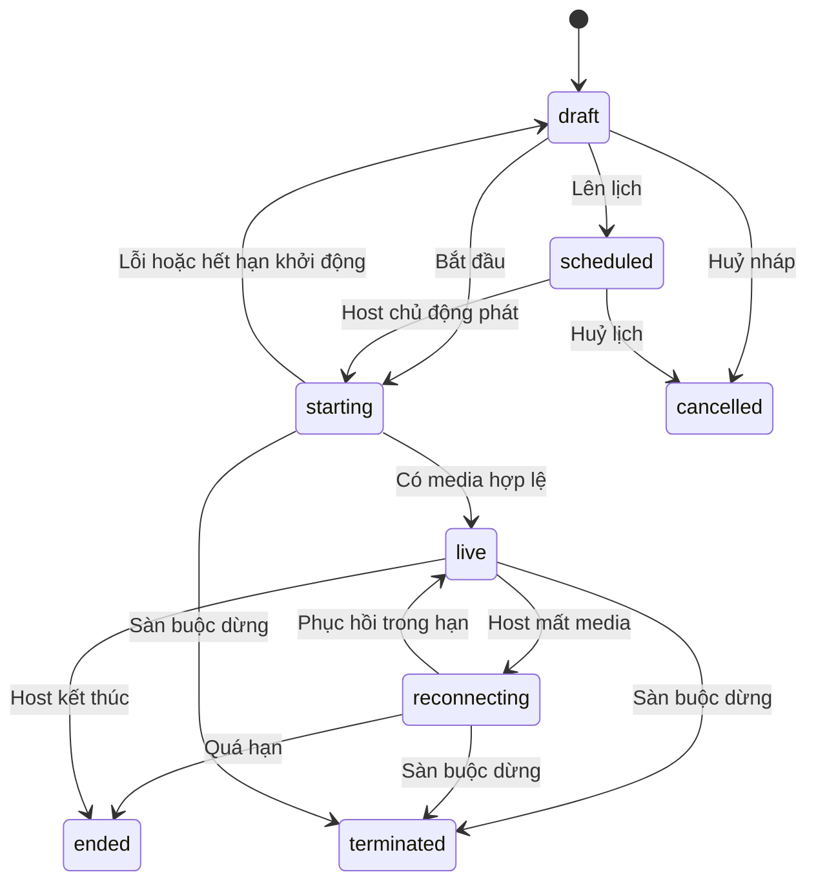

# PLAN-0045 — Kế hoạch FITLY Live bán hàng E2E

> Status: Implemented — kiểm tích hợp cục bộ đạt; chưa deploy, còn file audit bị chặn xoá theo biên bản bàn giao
> Ngày: 2026-11-06 · Owner: Codex
> Thẩm quyền hiện tại: chủ dự án đã yêu cầu triển khai code song song bằng agent; thay thế giới hạn chỉ thiết kế ở đợt trước.
> Liên quan: storefront PLAN-0015; admin/vendor PLAN-0008; AGENTS.md; docs/02_MODULE_MAP.md.
> Rà soát lần2: [biên bản và đặc tả bổ sung](PLAN-0045-livestream-review-2026-11-06.md). Bằng chứng triển khai và giới hạn kiểm thử: [biên bản nghiệm thu](PLAN-0045-livestream-implementation.md).
> Quyết định cuối theo uỷ quyền chủ dự án: [phạm vi A+B, policy FITLY_LIVE_V1, default và WP](PLAN-0045-livestream-final-decisions.md). Tài liệu này có ưu tiên cho mọi mục trước đó từng ghi chờ chốt.

## 1. Mục tiêu đã chốt

Xây FITLY Live theo UX phù hợp sàn hiện tại: xem/phát và mua hàng E2E, có voucher, quản trị, hậu mãi và phục hồi lỗi. Shopee là tham khảo ban đầu; theo chỉ đạo mới của chủ dự án không cần giống hoàn toàn. Chuẩn nghiệm thu là hành vi FITLY đã đặc tả, trải nghiệm mobile/desktop và tính đúng của đơn/tiền/quyền.

Không còn cổng phải đối chiếu màn Shopee có đăng nhập hoặc pixel-perfect. Nhãn X/Đ trong ma trận chỉ ghi nguồn khảo sát lịch sử, không phải việc còn treo. UX FITLY ở mục5/6 và quyết định cuối là chuẩn triển khai; không công bố replica1:1.

Mục tiêu demo: một shop phát, tối đa10 kết nối người xem thử, 720p/30fps; LiveKit Cloud truyền video, VPS giữ API/chat/nghiệp vụ. Bản giao gồm A+B; gói C không thuộc demo. Đây là mục tiêu kiểm thử, không phải năng lực đã đo. Không tự mua dịch vụ, tạo tài khoản, bật tính phí hay thay đổi VPS trong đợt thiết kế.

## 2. Cơ sở khảo sát và mức độ chắc chắn

Nguồn công khai được xem ngày 2026-11-06:

- [Shopee — giới thiệu Live](https://help.shopee.vn/portal/10/article/152966-T%C3%ACm-hi%E1%BB%83u-t%C3%ADnh-n%C4%83ng-Shopee-Live): xác nhận phát, gắn hàng, mua trong live, thiết lập trên điện thoại/PC. Ảnh minh hoạ là nguồn tham chiếu, chưa phải kiểm trực tiếp app hiện hành.
- [Shopee — hướng dẫn phát](https://shopee.vn/blog/cach-livestream-tren-shopee/): tham chiếu thiết lập, OBS và hoạt động tương tác; không sao chép chính sách thương mại thành luật FITLY.
- [Shopee — voucher live](https://shopee.vn/m/voucher-shopee-live): xác nhận nhóm ưu đãi dành cho mua qua live.
- [Shopee — tính năng đấu giá](https://help.shopee.vn/portal/4/article/85537): tham chiếu chương trình chọn người thắng, không mặc định là sàn đấu giá trả giá tăng dần.
- [LiveKit — quyền token](https://docs.livekit.io/home/server/generating-tokens), [self-host](https://docs.livekit.io/transport/self-hosting/), [bảng giá](https://livekit.com/pricing): đầu vào cho lựa chọn hạ tầng; không phải thiết kế nội bộ Shopee.
- Rà soát lần2 bổ sung [voucher và nhãn hàng từ live](https://help.shopee.vn/portal/4/article/101231-%5BShopee-Live%5D-H%C6%B0%E1%BB%9Bng-d%E1%BA%ABn-s%E1%BB%AD-d%E1%BB%A5ng-Voucher-Shopee-Live), [ghi nhận đơn KOL](https://help.shopee.vn/portal/10/article/164061), [phát thử](https://help.shopee.vn/portal/10/article/151627), [hoàn voucher](https://help.shopee.vn/portal/4/article/188931). Phạm vi và giới hạn suy luận được ghi trong biên bản, không áp nguyên chính sách affiliate cho mọi shop.

Code FITLY được đối chiếu: vendor ShopContextGuard; promotion schema/gateway; order/cart/payment/shipping; storefront layout, VariantPicker/useVariantPicker; sidebar/theme admin. Tại thời điểm khảo sát thiết kế ban đầu chưa có module livestream, media server, WebSocket gateway cho phòng live hay chức năng theo dõi shop; các phần này đã được xây trong đợt triển khai tiếp theo, xem biên bản implementation. Thông báo hiện tại không tự cung cấp realtime chat.

## 3. Phạm vi và ma trận đối chiếu

Ký hiệu nguồn khảo sát: **X** = nhóm hành vi được tài liệu công khai xác nhận; **Đ** = đặc tả riêng của FITLY. X không có nghĩa đã kiểm đúng từng pixel; Đ không còn là cổng chờ đối chiếu Shopee.

| ID | Chức năng/luồng | Cơ sở | Màn FITLY | Gói |
|---|---|---|---|---|
| L01 | Khám phá live, vào từ shop/sản phẩm/link | Đ | U01/U02 | A |
| L02 | Video, âm thanh, bật tiếng, toàn màn hình | X/Đ | U02 | A |
| L03 | Bình luận, phản hồi, ghim bình luận | X/Đ | U02/V04 | A |
| L04 | Thả tim, chia sẻ, số người xem | Đ | U02 | A |
| L05 | Theo dõi shop, nhắc lịch phát | X/Đ | U01/U02/V02 | B |
| L06 | Giỏ sản phẩm live, đánh số, tìm kiếm | X/Đ | U03/V03 | A |
| L07 | Ghim sản phẩm đang giới thiệu | X/Đ | U02/V04 | A |
| L08 | Chọn biến thể, thêm giỏ, mua ngay | X/Đ | U04/U05 | A |
| L09 | Voucher live, nhận và dùng khi checkout | X/Đ | U06/U05 | B |
| L10 | Tiếp tục xem/thu nhỏ khi mua, quay lại live | Đ | U02/U05 | B |
| L11 | Tạo phiên, ảnh bìa, tiêu đề, mô tả | X | V02 | A |
| L12 | Lên lịch và thông báo người theo dõi | X/Đ | V02 | B |
| L13 | Chọn/xếp thứ tự sản phẩm trước và trong live | X/Đ | V03/V04 | A |
| L14 | Kiểm camera/micro, preview, đếm ngược phát | X/Đ | V03 | A |
| L15 | Phát từ camera trình duyệt | Đ | V03/V04 | A |
| L16 | Phát bằng OBS, khoá luồng riêng | X/Đ | V03 | C |
| L17 | Điều hành: xoá chat, cấm chat, nhân viên hỗ trợ | Đ | V04/V06 | A/B |
| L18 | Kết thúc và dữ liệu phiên live | X/Đ | V05 | A/B |
| L19 | Báo cáo nội dung, quản trị dừng phiên | X/Đ | U07/A01/A02 | A |
| L20 | Kết nối lại khi host/người xem mất mạng | Đ | U02/V04 | A |
| L21 | Ghi hình, phát lại, quản lý bản ghi | Đ | U08/V07 | C |
| L22 | Chọn người thắng/ưu đãi nhanh tay, minigame | X/Đ | U09/V08 | C |
| L23 | Xu thưởng, nhận thưởng, dùng xu, hoàn xu | X/Đ | U10/V09 | C |
| L24 | KOL/affiliate và ghi nhận hoa hồng | X/Đ | V10/A03 | C |
| L25 | Đồng dẫn/mời khách lên sóng | Đ | U11/V11 | C |
| L26 | Nhãn nguồn live trong giỏ/checkout và mua sau khi rời live | X/Đ | U03/U05/giỏ hiện tại | A/B |
| L27 | Mua ngay tách biệt giỏ, khôi phục kết quả đặt đơn mất phản hồi | Đ | U04/U05 | A |
| L28 | Xem chi tiết/đánh giá shop rồi quay lại live | X/Đ | U02/chi tiết hiện tại | B |
| L29 | Phát thử riêng trước phiên thật | X/Đ | V03 | A |
| L30 | Huỷ/hoàn và phục hồi ưu đãi theo chính sách campaign | X/Đ | U05/đơn hiện tại | B |
| L31 | Sửa/huỷ lịch và thông báo đúng phiên bản | Đ | V01/V02/U01 | B |
| L32 | Lỗi media/chat/API riêng, quota và dừng chưa xác nhận từ provider | Đ | U02/V04/A02 | A |
| L33 | Số thứ tự sản phẩm ổn định, nội dung live đang trễ | Đ | U02/U03/V04 | A |

A+B là phạm vi hoàn chỉnh bản demo đã chốt; A/B là mốc triển khai nội bộ. C được giữ làm backlog tương lai, không là cổng chặn. Không đặt nút xu/đấu giá/xem lại giả; phần ngoài phạm vi không xuất hiện như chức năng đang hoạt động.

## 4. Kiến trúc thông tin và route dự kiến

| Mã | Route/màn | Nội dung |
|---|---|---|
| U01 | /live | Khám phá; đang phát/sắp phát; lọc ngành và tìm shop; phân trang server |
| U02 | /live/[id] | Phòng live, video, chat, sản phẩm ghim |
| U03 | Panel sản phẩm trong U02 | Tìm/xem hàng gắn với phiên; đóng trở về video |
| U04 | Panel biến thể trong U02 | Chi tiết ngắn, trục biến thể theo ngành, số lượng |
| U05 | /checkout hiện tại | Giữ luồng đặt hàng; thêm ngữ cảnh live đã được BE kiểm |
| U06/U07 | Panel voucher/báo cáo | Mỗi lần chỉ mở một panel phủ trên phòng |
| U12 | /account/vouchers | Kho claim của tôi, điều kiện/expiry/restore và Mua lại; bổ sung mới trong promotion |
| U08–U11 | Replay/game/xu/đồng dẫn | Màn mở rộng; chờ thiết kế chi tiết gói C |
| V01 | /vendor/livestreams | Danh sách phiên: nháp, đã lên lịch, đang phát, đã kết thúc |
| V02 | /vendor/livestreams/new; /[id]/edit | Thông tin, sản phẩm, ưu đãi, lịch |
| V03 | /vendor/livestreams/[id]/studio | Thiết bị, preview, kiểm kết nối, bắt đầu |
| V04 | Cùng route studio khi live | Video, chat, sản phẩm, điều hành, kết thúc |
| V05 | /vendor/livestreams/[id]/report | Phễu xem→click→đơn; đơn huỷ/hoàn tách riêng |
| V06 | Panel nhân viên điều hành | Chỉ chọn thành viên đang hoạt động của shop |
| A01 | /livestream/sessions | Phiên toàn sàn, bộ lọc trạng thái/shop |
| A02 | /livestream/reports; /sessions/[id] | Hàng đợi báo cáo, xem phiên, dừng/khoá quyền |
| A03 | Báo cáo/đối soát affiliate | Chờ gói C, dùng module tài chính phù hợp |

Sidebar shop thêm nhóm “Livestream”: Phiên livestream, Lịch phát, Dữ liệu. Sàn thêm “Livestream”: Phiên phát, Báo cáo nội dung. Storefront thêm điểm vào “Live” ở menu desktop/mobile và badge shop đang live; không bỏ các mục đang có.

## 5. Thiết kế giao diện tương thích FITLY

### 5.1 Nhận diện và thành phần

- Giữ coral #ff6f61 (`--primary`), nền trắng #ffffff, nền nhẹ #f8f8f8 (`--surface` khi phù hợp), chữ #1b1a20, đường phân cách #e5e5e5, sân khấu video #111114. Giá trị triển khai lấy token hiện hành, không rải hex mới trong component. Màu trạng thái lỗi/thành công lấy semantic token đang có.
- Storefront: Be Vietnam Pro cho điều khiển/chat/số liệu; Playfair Display chỉ ở tiêu đề trang khám phá như trang hiện tại. Không dùng serif cho chat, giá hoặc nút mua.
- Vendor/admin: giữ font sans, sidebar than tối, primary coral, Table/Card/Dialog/Sheet của shadcn hiện có. Không mang CSS Bootstrap sang admin, không mang Tailwind/shadcn sang storefront.
- Điểm nhấn nhận diện: thẻ sản phẩm được ghim có số thứ tự coral, xuất hiện nhất quán trong video, giỏ live và studio.
- Bố cục chức năng tham chiếu Shopee; logo, tên, typography, màu và component là FITLY. Bản web đáp ứng nhiệm vụ tương đương app; không hứa hành vi hệ điều hành như PiP/background media giống native.
- 390px phải dùng được; vùng chạm tối thiểu44px; safe-area, 100dvh, bàn phím không che ô chat; tương phản chữ trên video qua lớp nền; focus nhìn thấy và hỗ trợ reduced-motion.

### 5.2 Phòng xem desktop

```text
┌ FITLY · Live ──────────────────────────────────────────── Đóng ┐
│ Shop · Theo dõi             TRỰC TIẾP · Người đang xem          │
├─────────────────────────────────────┬─────────────────────────┤
│                                     │ BÌNH LUẬN               │
│           VIDEO 9:16                 │ Tin ghim của shop       │
│     khung video giữ đúng tỉ lệ       │ Khách: hỏi sản phẩm     │
│     ảnh ngang không kéo giãn         │ Shop: phản hồi          │
│                                     │                         │
│ [#03 · Ảnh · Tên · Giá] [Xem hàng]   │ [Nhập bình luận…] [Gửi] │
│ [Tiếng] [Toàn màn hình] [Chất lượng] │ [Sản phẩm] [Ưu đãi]     │
├─────────────────────────────────────┴─────────────────────────┤
│ Tiêu đề · Chia sẻ · Báo cáo · Shop đang giới thiệu #03          │
└───────────────────────────────────────────────────────────────┘
```

Video ở trái; panel phải chuyển giữa chat/sản phẩm/ưu đãi, mỗi lần một nội dung. Không hiện đồng thời nhiều bảng làm hẹp video. Màn từ1024px hai cột; tablet hẹp chuyển bố cục một cột theo không gian thực tế.

### 5.3 Phòng xem mobile và panel mua

```text
PHÒNG 390px                     PANEL SẢN PHẨM/BIẾN THỂ
┌──────────────────────────┐    ┌──────────────────────────┐
│ Shop  [Theo dõi]  Xem  × │    │ Video vẫn phát phía trên │
│ TRỰC TIẾP                │    ├──────────────────────────┤
│                          │    │ Sản phẩm trong live  [×] │
│       VIDEO              │    │ [Tìm sản phẩm]           │
│                          │    │ #01 Ảnh · Tên · Giá      │
│                          │    │ #02 Ảnh · Tên · Hết hàng │
│ Tin ghim                 │    ├──────────────────────────┤
│ Bình luận gần nhất       │    │ Ảnh · Giá BE · Còn hàng  │
│ #03 Ảnh · Tên · Giá [Mua]│    │ Trục1 / Trục2           │
│ Chat…  Hàng  Ưu đãi  Tim │    │ Số lượng                 │
└──────────────────────────┘    │ [Thêm giỏ] [Mua ngay]    │
                               └──────────────────────────┘
```

Panel sản phẩm và panel biến thể là hai trạng thái nối tiếp, không chồng hai modal có focus cùng lúc. Back từ biến thể về danh sách; Back lần nữa về video; Back khỏi phòng mới rời live. Biến thể dùng trục thật theo ngành, không mặc định mọi hàng đều có size/màu. Khi gõ chat, giảm vùng bình luận và tạm thu gọn sản phẩm ghim để ô nhập luôn thấy.

### 5.4 Studio shop desktop/mobile

```text
SIDEBAR FITLY │ Livestream / Tên phiên         [Kết thúc]
              │ Kết nối tốt · 00:12:30 · 8 người xem
              ├───────────────────────┬─────────────────┐
              │ Preview / video host  │ Chat + điều hành│
              │ Camera / Micro / Mạng │ Ghim / Xoá / Cấm│
              ├───────────────────────┴─────────────────┤
              │ Sản phẩm: Tìm · Thêm · Thứ tự · Ghim     │
              │ #01 [Ảnh] Tên · Giá · Tồn kho  [Ghim]    │
              │ #02 [Ảnh] Tên · Giá · Hết hàng [Bỏ ghim] │
              └─────────────────────────────────────────┘
```

Ở390px, sidebar giữ Sheet hiện tại; preview ở trên, dưới là tab Sản phẩm/Bình luận/Dữ liệu; chỉ một tab mở. Nút kết thúc phải xác nhận rõ, tách xa nút tắt micro. Màn tạo phiên dùng form của admin hiện tại: Thông tin → Sản phẩm/Ưu đãi → Thiết bị/Preview. Có lưu nháp, cảnh báo rời form chưa lưu. Không lấy toàn bộ500 sản phẩm vào một lần render.

## 6. Hành vi từng nhóm thao tác

### 6.1 Khách xem/tương tác

1. Vào U01: skeleton, danh sách đang live có ảnh bìa; rỗng thì thông báo và lịch sắp phát. Card không tự mở camera hoặc tự tải mọi video.
2. Mở U02: lấy metadata/quyền xem và media token; hiện đang kết nối. Bắt đầu muted theo quy tắc trình duyệt, có nút bật tiếng rõ. Không xin quyền camera/micro từ người xem.
3. Khách vãng lai xem được; bình luận/theo dõi/nhận voucher cần đăng nhập. Đăng nhập xong quay về đúng phiên/panel đang thao tác, không tự gửi lại bình luận cũ.
4. Chat: Enter gửi, Shift+Enter xuống dòng nếu ô nhiều dòng; giới hạn ký tự và tần suất bằng BE; trạng thái đang gửi/đã gửi/thất bại; thử lại cùng clientMessageId. Chỉ hiển thị tên công khai, không email/số điện thoại.
5. Tim: hiệu ứng cục bộ đáp ứng ngay, tổng được server gộp; không biến mỗi lần chạm thành một dòng DB; không dùng tim làm bằng chứng người thật.
6. Chia sẻ: ưu tiên native share nếu có, fallback sao chép link; thành công/thất bại có phản hồi. Báo cáo là panel có loại+lý do, xác nhận đã tiếp nhận; gửi báo cáo không tự dừng live.
7. Mất mạng: hiện kết nối lại, khoá gửi tạm; khi trở lại lấy snapshot + tin sau cursor, không nhân đôi. Phiên hết/đã bị dừng thì không tự kết nối lại vào phòng mới.

### 6.2 Mua hàng trong live

1. Bấm thẻ ghim/Mua của món đang giới thiệu → U04 trực tiếp; bấm biểu tượng giỏ sản phẩm live → U03, chọn món → U04. Đây là UX FITLY đã chốt, không cần đối chiếu Shopee để triển khai. Đổi món reset lựa chọn biến thể theo productId.
2. Chọn biến thể và số lượng; giá/tồn kho dùng dữ liệu BE. Hết hàng thì khoá mua, vẫn đọc được; ảnh hiển thị khớp biến thể. Thêm giỏ xong có toast và badge, vẫn ở live.
3. Mua ngay: tái sử dụng màn và bộ tính checkout/order hiện tại, nhưng cần bổ sung checkout intent độc lập chứa đúng SKU/số lượng của lệnh mua; không chỉ gọi hook Mua ngay đang có vì hook này thêm vào giỏ rồi mở checkout các dòng đang chọn. Không dùng thủ thuật bỏ tick rồi khôi phục giỏ. Intent không giữ kho; giữ kho ở lệnh tạo đơn. Xem biên bản §3.
4. Cập nhật giá/phí → dùng bước xác nhận giá mới đang có; không âm thầm tạo đơn theo giá cũ trong video. Hai khách mua SKU cuối thì giữ kho theo transaction, một khách nhận hết hàng.
5. Thanh toán dùng PayOS/COD hiện tại. Trở về từ PayOS phải hỏi lại trạng thái server, không tin query thành công. Không hứa video phát xuyên trang ngoài; quay về thì phục hồi phiên nếu còn live.
6. Ngữ cảnh nguồn live chỉ áp cho dòng mua thực sự từ phiên, không gắn toàn bộ giỏ nhiều shop vào live. Quan hệ attribution không cấp quyền ưu đãi. Đơn vẫn tách shop như hiện tại và đi tiếp GHN.
7. Nếu SKU đã có trong giỏ trước khi xem live, lượng cũ không tự thành lượng mua từ live. BE theo dõi nguồn theo phần số lượng; giỏ/checkout hiển thị rõ phần đủ điều kiện. Tăng/giảm/xoá/merge và chuyển giữa hai phiên có quy tắc tại biên bản §4, không gắn một sourceSessionId cho cả dòng gộp.
8. Timeout sau Đặt hàng phải có trạng thái “đang xác minh kết quả”, tra cứu/retry cùng checkout attempt. Reload hoặc mở lại không được tạo khoá mới khi kết quả cũ chưa rõ; không xoá giỏ để đoán đã thành công. Theo dõi thanh toán từng đơn con, không coi đơn cha đã trả chỉ vì một link PayOS thành công.
9. Chưa có địa chỉ/mã GHN, tuyến không phục vụ, quote lỗi và COD không đủ điều kiện có nhánh sửa/đổi phương thức rồi báo giá lại; không cho đặt với phí0 giả. Xem bảng lỗi trong biên bản §7.

### 6.3 Voucher live

- Panel liệt kê điều kiện, shop chịu/sàn chịu, sản phẩm áp dụng, số lượt còn và thời hạn BE trả; không tự tính giảm ở FE.
- “Nhận” idempotent theo người+campaign; chưa đăng nhập thì đăng nhập rồi xác nhận nhận lại. Nhận không đồng nghĩa đã dùng hoặc giữ tồn kho.
- Campaign thuộc phiên; chỉ nhận khi phiên đang live và có phiên xem hợp lệ được BE ghi nhận. Một admission không chứng minh người thực sự chú ý xem; không quảng cáo là chống gian lận tuyệt đối.
- Claim hợp lệ được dùng tới redeemUntil của campaign, kể cả live kết thúc bình thường; không mặc định hết hiệu lực ngay khi host dừng. UI ghi rõ thời hạn này.
- Hạn dùng đã chốt: actualStartedAt+24 giờ; policy FITLY_LIVE_V1 cùng luật restore tại quyết định cuối §3. Mỗi user1 claim/campaign và tối đa1 usage active; live kết thúc không tự gia hạn/thu hồi mã.
- Campaign bị quản trị thu hồi thì checkout từ chối, quote cũ phải được tính lại. Hạn mức dùng kiểm dưới khoá trong promotion/order; không tin source=live từ FE.
- Chuỗi trạng thái: Chưa nhận → Đã nhận → Đã dùng; nhánh Hết lượt nhận/Hết hạn/Đã thu hồi. Lượt nhận và lượt dùng là hai giới hạn khác nhau.
- Claim và mua từ live là hai điều kiện khác nhau: nhận mã không làm mọi món trong giỏ đủ điều kiện. Voucher live dùng một slot sàn hoặc slot shop tương ứng, không tự cộng thêm mã thứ ba vào checkout hiện hành. Điều kiện/tiền giảm/phân bổ thuộc promotion. Huỷ/hoàn toàn bộ covered quantities và nghĩa vụ tiền hoàn đã xong thì restore nếu còn hạn/chưa thu hồi; hoàn một phần không restore cả mã; nhiều lần hoàn cộng dồn đủ toàn bộ thì xét đúng một lần. Giữ expiry gốc, không phát bù/gia hạn tự động; recovery entitlement đúng SKU/quantity cho phép mua lại khi live đã kết thúc. Xem policy cuối §3 để thực hiện, không suy ra từ release usedCount hiện tại.

### 6.4 Shop tạo và điều hành

1. Chỉ shop approved và người có quyền mới tạo/phát. Chọn sản phẩm thuộc chính shop, đang active; tìm/phân trang server. Dữ liệu nháp lưu trước khi cấp token phát.
2. Preview: xin camera/micro sau hành động rõ của host, hiển thị lỗi thiết bị/quyền; chọn camera trước/sau trên thiết bị hỗ trợ. Chưa có video thì không được coi là đang phát.
3. Bắt đầu: BE claim duy nhất một phiên hoạt động/shop; token publish chỉ đúng host/room/nguồn camera-micro. Chờ track hoạt động mới chuyển live và gửi thông báo qua outbox.
4. Ghim một sản phẩm tại một thời điểm; đổi ghim tạo version mới. Client chậm nhận version thấp thì bỏ qua. Xếp thứ tự bằng kéo thả desktop, có nút lên/xuống cho mobile/bàn phím.
5. Moderator là thành viên được chỉ định, có quyền chat/sản phẩm theo phân công, không mặc nhiên có quyền phát/kết thúc/xem doanh thu. Không được mời user ngoài shop bằng ID bất kỳ.
6. Host reload: xác thực lại, claim quyền publish có lease; cùng actor không tạo phiên mới. Chuyển thiết bị cần xác nhận và thu hồi/ngắt publisher cũ. Một publisher chủ động cho mỗi phiên ở A/B.
7. Mất media: reconnecting trong khoảng chờ90s đã chốt, sau đó hệ thống kết thúc nếu không phục hồi. Đây là default FITLY cần kiểm thử, không phải số đo của Shopee; không reset giới hạn60 phút của phiên.
8. Kết thúc chủ động: dialog xác nhận, BE chặn token mới và ngắt phát, đặt phiên terminal. Thanh toán đang xử lý không bị huỷ chỉ vì live kết thúc.
9. Khoá shop/force-stop: hiệu lực tại token API, socket và media provider, audit lý do. Không chỉ ẩn card khỏi danh sách rồi để luồng cũ vẫn phát.
10. Có “Phát thử riêng” để kiểm đường truyền thật trước khi công khai; không chỉ preview camera cục bộ. Phòng thử có access control, TTL, không vào discovery/notification/doanh thu và không nhận voucher/đặt đơn thật. Chuyển sang phát chính thức tạo phiên production mới; xem biên bản §8.
11. Mã hàng #01/#02 ổn định trong cả phiên, tách displayNumber khỏi position. Đổi thứ tự không đổi số đã nói trên video; bỏ rồi thêm lại cùng product giữ số, số cũ không cấp cho món khác.

## 7. Trạng thái và phục hồi



scheduled không tự bật camera khi tới giờ; gửi nhắc host, không giả vờ đang live. Phiên scheduled bị quá giờ vẫn hiện chưa bắt đầu, có thông báo cho người chờ. ended/terminated/cancelled không mở lại; phát lần mới tạo ID mới. Không xoá lịch sử để tái dùng mã phiên.

| Tình huống | Phản hồi/khôi phục |
|---|---|
| Mic/camera bị từ chối | Hướng dẫn cấp quyền, thử lại, không chuyển live |
| Autoplay bị chặn | Nút Chạm để xem/bật tiếng |
| Người xem mất mạng | Reconnect + snapshot + cursor; đếm người xem theo TTL |
| Token hết hạn hoặc tài khoản bị khoá | Cấp lại khi còn quyền; nếu bị thu hồi thì đóng kết nối |
| Host đổi ghim trong lúc khách chọn biến thể | Giữ món khách đang chọn, cập nhật ghim phía sau, không đổi SKU ngoài ý muốn |
| Món bị ẩn/xoá, shop bị khoá | Dừng mua, tải trạng thái hiện tại; force-stop theo luật shop |
| Live kết thúc khi đang checkout | Checkout tiếp nếu hàng/ưu đãi còn hợp lệ; live hiện đã kết thúc |
| Webhook media lặp/đảo thứ tự | Inbox eventId unique, version/state guard, terminal không hồi sinh |
| BE restart, Redis mất dữ liệu | DB trạng thái bền vững; reconcile với provider; số online được dựng lại, không bịa số cũ |
| Chat bị xoá/cấm trong khi reconnect | Snapshot moderation là nguồn sự thật, không phát lại nội dung bị xoá |
| Video còn chạy nhưng chat/API lỗi, hoặc ngược lại | Chỉ khoá chức năng bị lỗi; hiển thị trạng thái từng kênh, không spinner thay cả phòng |
| Force-stop chưa được media provider xác nhận | Ngừng cấp quyền mới, ngừng công khai; admin thấy đang ngắt/chưa xác nhận và retry idempotent, không báo đã ngắt xong |
| Đặt đơn timeout/reload/tab khác | Khôi phục attempt gắn user và payload/version, xác minh đơn cũ trước thao tác tạo mới |

## 8. Tích hợp và ownership dự kiến

Module mới livestream/schema livestream sở hữu phiên, sản phẩm được gắn/ghim, chat, moderation, báo cáo nội dung, provider inbox/outbox/audit. Đọc sản phẩm/shop qua QueryApi; không import repository/service nội bộ module khác. JWT và ShopContextGuard hiện tại vẫn là nguồn quyền cho HTTP; socket phải có bước kiểm tương đương, không coi HTTP guard tự áp vào WebSocket.

- MediaProvider interface: tạo phòng, cấp quyền publish/subscribe, ngắt publisher, đóng phòng, đối chiếu trạng thái. LiveKit adapter là lựa chọn đầu, không lộ API secret ra FE.
- Realtime: Socket.IO/WSS cho phòng; Redis adapter khi nhiều API process; xác thực namespace/room, kiểm lại quyền ghi sau khi có sự kiện thu hồi. Kênh media/data không được vượt qua kiểm chat của BE.
- DB lưu chat đã chấp nhận trước khi ack/broadcast; sequence tăng trong phiên, clientMessageId unique theo actor+phiên. Có phân trang cursor; chat thô30 ngày, snapshot20/max50 tin mỗi trang, retention chứng từ theo quyết định cuối §2.
- Redis giữ heartbeat/presence TTL, gộp tim và cache; không dùng Redis làm sổ đơn/ưu đãi. Tính người đang xem theo viewer session còn heartbeat; định nghĩa unique user riêng, không gộp với kết nối.
- Theo dõi shop là tính năng mới do shop sở hữu, có API đọc/ghi phù hợp; livestream chỉ phát sự kiện/thông báo tới follower, không tạo bản follow riêng.
- Promotion sở hữu campaign/claim/consume/release của voucher; live cung cấp ngữ cảnh xem/phiên qua gateway ở common. Thiết kế DI tránh vòng import promotion↔livestream. Thu hồi campaign và kiểm claim xảy ra trong promotion khi quote/consume.
- Cart/order thêm provenance theo phần số lượng và checkout intent/attempt đã BE kiểm; snapshot nguồn vào order line/lot liên quan. Tham chiếu sourceSessionId/sourceProductId không đủ để nâng cả dòng gộp thành đủ điều kiện. Có liên kết order id qua QueryApi/outbox; không FK xuyên schema và không để livestream tự tạo order/payment. Chi tiết phục hồi ở biên bản §3–4, TTL/restore/API đã chốt ở quyết định cuối §2/3/8.
- Reporting doanh thu từ order/payment hiện tại; thống kê live phân biệt gross đặt, đã thanh toán, đã hoàn/huỷ. Tiền đều MoneyResponse của server.

### 8.1 Dữ liệu cho migration khi được yêu cầu triển khai

| Chủ quản | Thực thể dự kiến và bất biến |
|---|---|
| livestream | sessions: shopId, hostUserId, title, cover, schedule, state, providerRoomId, sessionVersion, thời điểm, lý do kết thúc |
| livestream | session_products: sessionId+productId unique, position; phiên chỉ tham chiếu hàng của shop |
| livestream | messages: sessionId, sequence, actor, clientMessageId, body, replyTo, moderation; unique chống gửi trùng |
| livestream | moderators, moderation_actions, reports: audit người thao tác/lý do/phạm vi |
| livestream | media_inbox, outbox, audit_logs, viewer admissions; idempotency và retention |
| shop | follows: userId+shopId unique; trạng thái thông báo theo dõi |
| promotion | live campaigns + claims, giới hạn nhận/dùng và redeemUntil; tiền/consume thuộc promotion |
| cart/order | Attribution dòng hàng + snapshot; đơn nhiều shop không bị gắn nhầm nguồn |
| order | Checkout intent/attempt có user, version, hàng chọn, nguồn, kết quả nhóm đơn; không phụ thuộc lifetime của component FE |
| Gói C | recordings, games/awards, affiliate; xu/hoa hồng cần ownership và sổ cái riêng trước migration |

Chưa tạo Prisma/schema SQL trong đợt này. Thiết kế DB chi tiết sau duyệt phải có trường metadata chuẩn, index, audit/outbox và DBML; không sửa migration cũ.

### 8.2 Nhóm API dự kiến, chưa phải hợp đồng đã tồn tại

- Public: GET /livestreams; GET /livestreams/:id; GET /:id/products; GET /:id/messages?after; POST /:id/viewer-session; POST /:id/reports.
- Shop: /shop/livestreams CRUD nháp/lịch; /:id/start; /:id/host-token; /:id/end; /:id/products; /:id/pin; /:id/moderation; /:id/report.
- Sàn: /admin/livestreams; /:id/terminate; /admin/livestream-reports; quyền phát của shop được quản lý bằng lệnh riêng, không đổi trạng thái shop chỉ vì cấm live.
- Event: message.accepted/deleted, product.pinned, session.state_changed, viewer.count_changed, campaign.updated; có sessionId, version/sequence, serverTime. Client có snapshot phục hồi, không dựa vào nhận đủ mọi event.
- REST thay đổi dữ liệu dùng idempotency/version; request start/end có kết quả đã thực hiện khi replay. Swagger/Orval sinh client sau khi hợp đồng được triển khai.

### 8.3 Quyền dự kiến

Vendor: shop.livestream.read, manage, broadcast, moderate, report.read; chủ shop được cấp preset, nhân viên được phân quyền rõ. Moderator theo phiên không nâng thành chủ shop.

Sàn: livestream.session.read, livestream.session.terminate, livestream.report.read/process, livestream.shop.restrict. UI lọc sidebar/nút, BE kiểm thật; dùng đúng catalog sinh mã, không gõ mã chưa có vào code hiện tại.

## 9. Phần mở rộng để tránh bỏ sót yêu cầu “đầy đủ”

| Nhóm | Luồng đề xuất | Điều kiện trước khi triển khai |
|---|---|---|
| Replay | Host bật ghi → processing → ready/failed → người xem xem bản ghi; giỏ replay dùng hàng/giá hiện tại, không phát ưu đãi cũ như còn hiệu lực | Provider recording, storage, retention, quyền xoá; video/timeline có mốc thời gian |
| Chọn người thắng | Shop tạo lượt ưu đãi → eligibility → mở tham gia → đóng theo serverTime → chọn winner → cấp quyền mua có hạn → nhận/không nhận | Xác định loại nhanh tay/ngẫu nhiên, giới hạn một người, chống trùng; không đồng nhất với đấu giá tăng giá |
| Xu | Shop/sàn cấp ngân sách → người xem đủ điều kiện → nhận một lần → sổ cái → dùng → hoàn theo đơn | Là nghiệp vụ giá trị mới, cần ví xu/ledger, ngân sách, hết hạn, rule hoàn; không tái dùng ví cọc COD |
| Affiliate/KOL | Chủ shop cho phép gắn hàng → affiliate giới thiệu → attribution → đơn qua thời gian hoàn → quyết toán | Quan hệ hợp tác và đối soát/hoa hồng mới; không cộng lại hoa hồng sàn hiện tại |
| Đồng dẫn | Mời → người được mời chấp nhận/cấp quyền camera → host duyệt lên sóng → xuống sóng/thu hồi | Nhiều publisher, bố cục video, quyền ghi hình và moderation; giới hạn cần kiểm tải |
| OBS | Host xin khoá → kết nối OBS → kiểm media → phát → reset/revoke khoá | Ingress, khoá là secret, không xuất hiện trong log/public payload |

Các nhóm C không nằm trong bản giao demo. Khi có yêu cầu mở rộng mới sẽ lập kế hoạch domain/acceptance riêng; không cần reference Shopee để hoàn tất A+B.

## 10. Kịch bản nghiệm thu đối chiếu

| Mã | Thao tác | Kết quả phải thấy |
|---|---|---|
| LIVE-01 | Shop tạo nháp→chọn hàng→preview→phát; khách mở link trên thiết bị khác | Chỉ chuyển live khi có hình/tiếng; viewer không bị xin camera |
| LIVE-02 | Hai tab cùng start, bấm start hai lần, reload host | Một phiên/một publisher, không tạo phòng rác |
| LIVE-03 | Khách gửi chat→moderator xoá/cấm→khách reconnect | Không gửi trùng, không hồi sinh chat xoá, cấm vẫn hiệu lực |
| LIVE-04 | Host đổi ghim liên tiếp; client nhận event đảo thứ tự | Cùng món ghim theo version mới nhất |
| LIVE-05 | Khách mở giỏ→biến thể→Back→Back | Về đúng panel và video, không rời live ngoài ý muốn |
| LIVE-06 | Hàng điện tử/chỉ một SKU/hàng thời trang | Trục biến thể đúng dữ liệu, không bắt size/màu giả |
| LIVE-07 | Mua ngay từ live khi giỏ đã có hàng shop khác | Chỉ mua dòng đã chọn, giỏ cũ không mất, nguồn đơn không bị gán sai |
| LIVE-08 | Hai khách mua hàng cuối/giá đổi/quote hết hạn | Kho và tổng do BE quyết; thông báo đủ, không oversell |
| LIVE-09 | Nhận voucher song song/replay/sửa source/live bị dừng | Không vượt hạn mức hoặc nhận trái điều kiện; redeemUntil rõ |
| LIVE-10 | COD và PayOS→shop xử lý→GHN→webhook | Luồng đơn hiện tại hoạt động; không giả cập nhật giao thành công |
| LIVE-11 | Host mất mạng rồi phục hồi/quá90s | Reconnecting→live/ended đúng; không phát thông báo bắt đầu lặp |
| LIVE-12 | Sàn force-stop hoặc khoá shop khi đang phát | Media/socket/token bị xử lý, lý do hiển thị, có audit |
| LIVE-13 | Mobile390px, landscape, bàn phím, focus/Back, giảm chuyển động | Không tràn ngang, ô chat/nút mua thấy được, chỉ một dialog giữ focus |
| LIVE-14 | Live kết thúc khi PayOS đang xử lý; quay lại từ trang ngoài | Không huỷ đơn vì hết live; lấy trạng thái thanh toán từ BE |
| LIVE-15 | 1 host+10 viewers thực trong15–30 phút | Ghi CPU/RAM/băng thông, thời gian mở hình, độ trễ video/chat, reconnect; không lấy mock làm bằng chứng chịu tải |
| LIVE-16 | Từng màn/luồng theo UX FITLY, desktop và390px | Đúng vị trí tác vụ và phản hồi đã đặc tả, không thiếu/nút giả; không yêu cầu match pixel Shopee |

Rà soát lần2 mở rộng checklist tới L33, thêm LIVE-17–36 trong biên bản §9; quyết định cuối §5 thêm7 ví dụ policy bắt buộc. Chỉ lấy các mục A+B làm phạm vi demo, không dùng bộ16 ca ban đầu làm toàn bộ cổng nghiệm thu mua hàng.

Chỉ tiêu đề xuất để đo trong demo: video mở trong5s, chat phản hồi trong1s ở mạng thử ổn định; chưa có kết quả đo hoặc bảo đảm mọi mạng. Dữ liệu mẫu/demo phải gắn nhãn, không bịa viewer/đơn/doanh thu. Paid service/hạ tầng thật cần cấu hình của chủ dự án khi bước triển khai được cho phép.

## 11. Trình tự triển khai và cổng kiểm đã chốt

Thực hiện WP1–WP7 trong quyết định cuối §6: contract/schema/quyền → media/phát thử → studio/chat/hàng → intent/lot/attempt/checkout → voucher V1/restore → discovery/follow/lịch/player/admin/report → E2E/visual/load/runbook/cleanup. Media spike1host+2viewer là cổng sớm; trước nghiệm thu đo1host+10viewer15–30 phút.

Không còn bước chờ đăng nhập Shopee hoặc duyệt lại policy. Kế hoạch đã đủ quyết định cho A+B; credentials và kiểm hạ tầng là đầu vào lúc triển khai, không biến thành yêu cầu viết code trong đợt thiết kế. C là backlog, chỉ mở khi được yêu cầu thêm.

## 12. Checklist của đợt thiết kế

- [x] Khảo sát tài liệu công khai Shopee và cấu trúc FITLY.
- [x] Lập ma trận chức năng, màn, hành vi, trạng thái và kiểm thử.
- [x] Chọn hướng media phù hợp demo và quy tắc dùng lại checkout/GHN.
- [x] Đặt ràng buộc nhận diện, stack, mobile và ownership.
- [x] Theo uỷ quyền chủ dự án, chốt UX FITLY thay cổng replica Shopee1:1.
- [x] Chốt phạm vi demo A+B, default/retention/WP và policy FITLY_LIVE_V1; C là backlog.
- [x] Viết code/migration/API/UI, mẫu cấu hình media và harness kiểm thử riêng; cấu hình Cloud/deploy thực tế là bước vận hành sau.

Chỉ thêm/chỉnh tài liệu thiết kế trong docs/plans của ba repo. Không thay code, cài package, sinh API, chạy migration, mở dịch vụ, commit/push/deploy hoặc tạo dữ liệu test trong đợt này. Rà soát lần2 đã bổ sung luồng còn thiếu; mọi trạng thái “đã bổ sung” là ở mức tài liệu, không phải đã code/test runtime.

2026-11-06, quyết định cuối: chủ dự án bỏ yêu cầu giống Shopee hoàn toàn và giao tự chốt. Kế hoạch được hoàn thiện theo FITLY, không còn hai cổng nghiệp vụ/đối chiếu treo; chưa bắt đầu triển khai.
