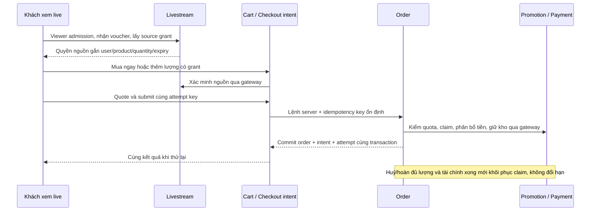

# PLAN-0045 — Triển khai FITLY Live A+B

Ngày triển khai: 2026-11-06. Chủ dự án đã cho phép code và chạy agent song song. Quyết định nghiệp vụ tại [final decisions](PLAN-0045-livestream-final-decisions.md) vẫn là chuẩn; không còn yêu cầu sao chép hoàn toàn Shopee.

## Phạm vi code

- Module `livestream` sở hữu phiên, sản phẩm ghim/thứ tự, chat/moderation, admission/source grant, media webhook, quota, lịch/thông báo/follow và quyền vận hành. LiveKit adapter truyền hình/tiếng; Socket.IO và Redis mang sự kiện nghiệp vụ. DB là nguồn trạng thái, không tin dữ liệu giỏ từ client để cấp ưu đãi.
- Storefront có `/live`, phòng xem, các panel chat/sản phẩm/voucher, variant picker dùng chung, thu nhỏ player, intent checkout riêng, ví phiếu và mua lại sau khôi phục.
- Vendor có danh sách/lịch, cấu hình, camera preview/phát thử/studio, ghim hàng, quản lý moderator/voucher và báo cáo. Sàn có giám sát, xử lý report, dừng và hạn chế shop; quyền BE và UI đồng bộ catalog.
- Cart lưu nguồn theo lượng, thêm có request ID và receipt chống dùng lại grant. Giảm lượng/trả lượng dùng LIFO có snapshot cả phần thường, tránh gán ưu đãi nhầm khi cùng SKU.
- Checkout intent tách `buy_now` khỏi giỏ; `cart_selection` tiêu thụ đúng snapshot và giữ lượng thêm sau. Order/intent/attempt thành công commit cùng transaction. Unknown giữ attempt/lease và dùng lại idempotency key; GET attempt chưa nhận đóng khoá cũ trước khi cho xác nhận lại, chặn POST đến muộn.
- Promotion thực thi `FITLY_LIVE_V1`: claim theo admission, tối đa một usage active, đúng nguồn/số lượng/shop, expiry cố định lần phát đầu+24h. Huỷ/hoàn đủ phần áp mã và hết nghĩa vụ tài chính mới release một lần; recovery giới hạn SKU/lượng cũ. Snapshot phân bổ tiền ròng phục vụ hoàn tiền, không lấy giá mới hoặc trừ nguyên mệnh giá mã.
- Migration `20261106150000_livestream_commerce`, schema-per-module và DBML; seed draft idempotent không tự phát hoặc tạo giao dịch thật.

## Đường đi chính

## Bằng chứng đã thực hiện

Mọi kiểm thử ghi dùng PostgreSQL16/pgvector `fitly_live_audit` localhost55446, Redis56392, API4006, LiveKit cục bộ7880, hai FE3415/3416 và browser audit riêng. Không dùng DB triển khai, không đọc `.env` thật, không dùng key thanh toán/OpenAI/Cloud. Các thông số audit không phải cấu hình triển khai.

| Cổng | Bằng chứng |
|---|---|
| Video thật cục bộ | Browser host canvas+WebAudio publish; viewer độc lập subscribe cả hình/tiếng, video640×360 giải mã6frame; storefront thật nhận320×180 và hơn56frame |
| HTTP thương mại | `scripts/audit/live-commerce-audit.ts` đã qua: mua ngay giữ giỏ, replay cùng group, owner404, khoá attempt chưa nhận, snapshot giỏ giữ lượng thêm sau |
| Voucher HTTP | Cùng SKU có2 thường+1live chỉ giảm50.000đ với mã50%; add retry giữ3 chiếc; COD huỷ→claim restored giữ nguyên expiry→recovery chỉ1chiếc và đúng50.000đ |
| Admin browser | 7 màn ở390px không tràn ngang, camera preview thật1280; draft audit được huỷ. Không tuyên bố đã publish bằng toàn bộ UI khi phiên core đang chiếm quota |
| Storefront browser | Đăng nhập/khám phá, video thật, panel390px, mini-player giữ qua navigation, claim/wallet; UI đặt COD nhóm `DHN2611060009`, con `DH2611060009`, tổng80.000đ sau voucher50.000đ. Giỏ2chiếc cũ giữ nguyên; reload về cùng đơn, pointer pending được xoá |
| Regression cuối | Lint toàn repo đã kiểm; các lỗi test/harness mới sửa và focused lint đạt0. Boundaries542module/3541dependency đạt; build exit0; toàn bộ **104suite/2544test** đạt. Có regression500 unknown giữ cùng lệnh/key, LIFO, tiền hoàn/rounding, quota/claim/policy |
| Migration/seed | 50migration áp DB riêng; drift cuối không khác. Seed livestream chạy2lần vẫn đúng1draft,0view/token; không tự phát |
| Dừng phiên thật | LiveKit1.13.11 self-host `auto_create:false`: terminate→mediaStopStatus confirmed; token host cũ còn hạn bị từ chối reconnect, không tạo lại room |
| Worker/realtime | Worker thật boot, durable pin outbox→Redis→Socket.IO tới phòng đúng; JWT khác shop bị từ chối. SMTP audit không chạy nên email gửi ngoài chưa kiểm |
| Khám phá | Lọc ngành lá và tìm theo tên shop được xử lý trước phân trang; HTTP16phiên→15+1, trang không trùng; FE390px chọn ngành/đổi URL/resetpage, không lỗi hydration |
| Admission | 10kết nối được nhận, kết nối11 nhận409;30heartbeat cùngIP được chấp nhận, guest khác không được dùng admission, guest không đọc rehearsal. Đây là kiểm cổng quyền/quota, không phải benchmark10luồng video |

## Giới hạn và vận hành

LiveKit Cloud là lựa chọn triển khai mặc định. Ba biến BE `EF_LIVEKIT_URL`, `EF_LIVEKIT_API_KEY`, `EF_LIVEKIT_API_SECRET` phải cấu hình trên API và worker; webhook media là `/api/v1/livestreams/media/webhook` với chữ ký LiveKit. Không đưa secret lên FE. Hai FE dùng cùng API và socket origin đúng CORS; HTTPS/WSS cho trình duyệt ngoài localhost.

Mẫu `deploy/livekit.example.yaml` dành riêng cho kiểm self-host: `room.auto_create: false` để token cũ không tự tạo lại room đã xoá. Không đưa devkey/secret cục bộ lên VPS. Xem [runbook](../12_OPERATIONS_RUNBOOK.md) và [keys checklist](../07_KEYS_CHECKLIST.md).

Không gọi PayOS thật, không phát trên LiveKit Cloud, không benchmark tải10viewer hoặc cam kết720p/độ trễ. Không push/deploy hay tự tạo tài khoản Cloud. Gói C (OBS/replay/xu/game/affiliate/cohost) vẫn ngoài phạm vi. Cấu hình key, webhook công khai và UAT trên thiết bị/mạng thật là nghiệm thu vận hành sau.

## Kiểm cuối và dọn dẹp

Kết quả cuối: backend boundaries542module/3541dependency đạt, build đạt, **104suite/2544test đạt** sau các sửa cuối; lint các file mới/sửa đạt. Hai FE lint/typecheck/build đạt, các sửa lọc ngành cuối được kiểm thêm browser/lint/typecheck. Cả3repo `git diff --check` đạt. Không commit/push/deploy.

Đã dừng API/worker, hai FEdevserver, mediaharness và Chrome audit. Đã xoá đúng3container `fitly-live-media-audit`, `fitly-live-redis-audit`, `fitly-live-db-audit` cùng2anonymousvolume chứa DB/Redis; kiểm lại không còn container/volume đó, không listener4006/3415/3416/55446/56392/7880/7881/9229. Dữ liệu giao dịch/claim/user/seed audit mất cùng DB riêng; không thay DB triển khai. Giữ source, migration, test/harness và dependency/buildcache cần cho phát triển.

**Còn sót file do automatic approval review từ chối xoá với lý do `blocked by policy` (không nêu nguyên nhân chi tiết):**

- Thư mục `D:\Fullstack\eco_fashion\.live-browser-audit` (profile Chrome đã dừng).
- Trong `C:\Users\ASUS\AppData\Local\Temp`: `fitly-live-fixtures.json`, `fitly-live-be-final-verify.log`, `fitly-live-be-verify.log`, `fitly-live-commerce-tests.log`, `fitly-live-delivery-tests.log`, `fitly-live-final-all-tests.log`, `fitly-live-final-fixes-lint.log`, `fitly-live-final-tests.log`, `fitly-live-reconcile-lint.log`, `fitly-live-reconcile-tests.log`, `fitly-live-root-final-lint.log`, `fitly-live-root-lint.log`, `fitly-live-unknown-test.log`.

Lệnh xoá recursive thư mục và lệnh xoá danh sách file cụ thể có kiểm đường dẫn đều bị chặn; không thử đường khác để vượt chặn. Chủ dự án có thể xoá các mục liệt kê bằng File Explorer. Không được công bố đã dọn sạch toàn bộ filesystem. Các file/ảnh và `.visual-browser-audit` từ đợt cũ nằm ngoài cleanup của đợt Live này.
